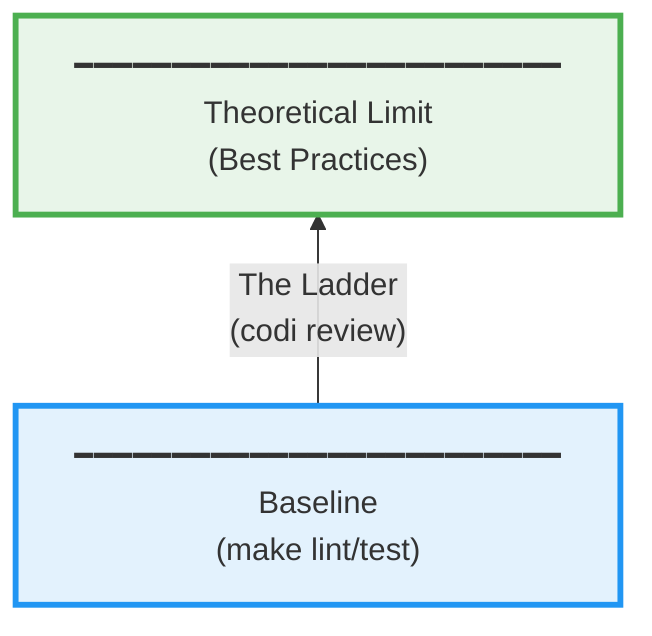

# codi

**Quality framework for AI-driven development**

[中文文档](README.zh-CN.md)

---

## The Problem

AI writes code fast, but doesn't know your quality standards:
- Missing error handling
- Ignores architecture patterns
- Requires constant reminders

## The Solution

```
Standards first → AI writes by standards → AI reviews by standards → AI auto-fixes
```

codi provides the standards library + automation toolchain.

---

## Three Boundaries: The Essence of Engineering Quality



**Inspired by Wu Jun's "Three Boundaries" framework**

- **Baseline**: Guaranteed by tools (lint, test)
- **Limit**: Defined by best practices (error handling, architecture)
- **Ladder**: The climb from baseline to limit (codi review)

---

## What codi Does

### 1. Define Standards (The Limit)

Standards files define project quality rules:

```
standards/
├── universal/           # All projects
│   ├── security-principles.md
│   ├── database-principles.md
│   └── api-design.md
├── go/
│   ├── core/            # Go core
│   │   ├── error-handling.md
│   │   ├── concurrency.md
│   │   └── interfaces.md
│   └── github.com/gin-gonic/gin.md  # Dependency standards
└── python/
    ├── core/
    └── fastapi.md
```

**Zero-mapping**: dependency path = standard path
```
import "github.com/gin-gonic/gin"
       ↓
standards/go/github.com/gin-gonic/gin.md
```

### 2. Automate The Ladder (Review Command)

```bash
codi review              # AI auto-review + fix
```

**How it works**:
1. Invokes AI's `/code-review` capability
2. Loads project standards as context
3. AI finds issues → reads standards → fixes → commits

**This is the ladder: AI automatically pushes code from baseline to limit.**

### 3. Provide Scaffolding (The Baseline)

```bash
codi init my-api         # Generate project skeleton
```

**Not a code generator, but a development framework**:
- Directory structure (following standards)
- Toolchain config (lint, test, hooks)
- Makefile (unified command interface)
- Standards files (.claude/CLAUDE.md)

**You fill in business logic, tools guarantee quality baseline.**

---

## 5-Minute Quickstart

### New Project

```bash
# 1. Generate project
codi init my-api
cd my-api

# 2. See what's generated
ls -la
# .claude/CLAUDE.md              ← AI's project knowledge base
# .codi/standards/                ← Standards files (local copy)
# Makefile                        ← make lint/test/build

# 3. Write code
vim internal/handler/user.go

# 4. AI auto-review
codi review

# 5. Commit
git commit -m "feat: add user handler"
```

### Existing Project

```bash
cd your-project

# 1. Analyze project, generate standards config
codi adopt

# 2. AI review
codi review

# Done! AI now knows project standards
```

---

## Core Value

### Not a Tool, But a Workflow

**codi is NOT**:
- ❌ Code generator (that's AI's job)
- ❌ Linter (that's baseline tools)
- ❌ Documentation generator

**codi IS**:
- ✅ Standards definition and distribution system
- ✅ AI-driven quality automation loop
- ✅ Evolvable development framework

### Key Design Principles

**1. Standards as Code**
```markdown
Markdown files = Human-readable + AI-parseable + Git-manageable
```

**2. Dependency-Driven**
```
Use Gin → Show Gin standards
Don't use Django → Don't show Django standards
```

**3. Zero-Config**
```
Dependency path = Standard path (zero-mapping)
Project type auto-detected (CLI/API)
Standards auto-filtered (relevant only)
```

**4. Composable**
```
Baseline (tools) + Limit (standards) + Ladder (review) = Quality
```

---

## CLI Reference

```bash
codi init <name>        # Create project framework
codi adopt              # Integrate into existing project
codi sync               # Update after dependency changes
codi review             # AI auto-review + fix
codi review --dry-run   # Preview prompt
codi status             # Project status
codi view [language]    # Browse standards
```

---

## Extending codi

### Add New Language

```bash
# 1. Create standards directory
mkdir -p standards/rust/core

# 2. Write standards files
cat > standards/rust/core/error-handling.md << 'EOF'
# Rust Error Handling

Use `Result<T, E>` for recoverable errors...
EOF

# 3. Implement analyzer (optional)
# internal/analyzer/rust.go
```

### Add New Library Standard

```bash
# Zero-mapping: path = file path
# Using tokio/axum?

echo "# axum Best Practices" > standards/rust/tokio/axum.md
# Done! Auto-loads on next codi sync
```

---

## License

MIT License - see [LICENSE](LICENSE)
