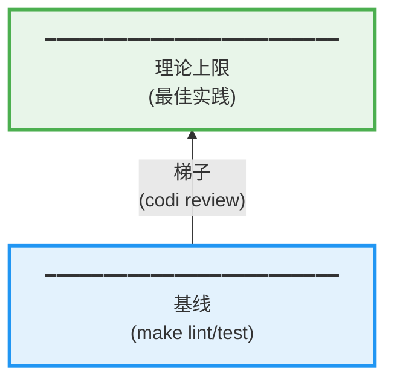

# codi

**AI 驱动开发的质量框架**

[English](README.md)

---

## 问题

AI 写代码很快，但不知道你的质量标准：
- 错误处理缺失
- 不遵循架构规范
- 每次都要重复提醒

## 解决方案

```
标准先行 → AI 按标准写 → AI 按标准 review → AI 自动修复
```

codi 提供标准库 + 自动化工具链。

---

## 三个边界：工程质量的本质



**灵感来自吴军《格局》**

- **基线**：工具自动保证（lint、test）
- **上限**：最佳实践定义（error handling、architecture）
- **梯子**：从基线爬到上限的过程（codi review）

---

## codi 做什么

### 1. 定义标准（The Limit）

标准文件定义项目的质量规范：

```
standards/
├── universal/           # 所有项目
│   ├── security-principles.md
│   ├── database-principles.md
│   └── api-design.md
├── go/
│   ├── core/            # Go 核心
│   │   ├── error-handling.md
│   │   ├── concurrency.md
│   │   └── interfaces.md
│   └── github.com/gin-gonic/gin.md  # 依赖标准
└── python/
    ├── core/
    └── fastapi.md
```

**零映射**：依赖路径 = 标准路径
```
import "github.com/gin-gonic/gin"
       ↓
standards/go/github.com/gin-gonic/gin.md
```

### 2. AI 自动执行（The Ladder）

```bash
codi review              # AI 按标准 review + 自动修复
```

**内部流程**：
1. 调用 AI 的 `/code-review` 能力
2. 加载项目标准作为上下文
3. AI 发现问题 → 读标准 → 修复 → 提交

**这就是梯子：AI 自动把代码从基线推向上限。**

### 3. 提供脚手架（The Baseline）

```bash
codi init my-api         # 生成项目骨架
```

**不是代码生成器，是开发框架**：
- 目录结构（遵循标准）
- 工具链配置（lint、test、hooks）
- Makefile（统一命令接口）
- 标准文件（.claude/CLAUDE.md）

**你填充业务逻辑，工具保证质量基线。**

---

## 5 分钟上手

### 新项目

```bash
# 1. 生成项目
codi init my-api
cd my-api

# 2. 看看生成了什么
ls -la
# .claude/CLAUDE.md      ← AI 的项目知识库
# .codi/standards/       ← 标准文件副本
# Makefile               ← make lint/test/build

# 3. 写代码
vim internal/handler/user.go

# 4. AI 自动 review
codi review

# 5. 提交
git commit -m "feat: add user handler"
```

### 现有项目

```bash
cd your-project

# 1. 分析项目，生成标准配置
codi adopt

# 2. AI review
codi review

# 完成！AI 现在知道项目标准了
```

---

## 核心价值

### 不是工具，是工作方式

**codi 不是**：
- ❌ 代码生成器（那是 AI 做的）
- ❌ Linter（那是基线工具）
- ❌ 文档生成器

**codi 是**：
- ✅ 标准的定义和分发系统
- ✅ AI 驱动的质量自动化闭环
- ✅ 可演进的开发框架

### 关键设计

**1. 标准即代码**
```markdown
Markdown 文件 = 人能读 + AI 能解析 + Git 能管理
```

**2. 依赖驱动**
```
用 Gin → 显示 Gin 标准
不用 Django → 不显示 Django 标准
```

**3. 零配置**
```
依赖路径 = 标准路径（零映射）
项目类型自动检测（CLI/API）
标准自动过滤（只看相关的）
```

**4. 可组合**
```
基线（工具）+ 上限（标准）+ 梯子（review）= 质量
```

---

## CLI 参考

```bash
codi init <name>        # 创建项目框架
codi adopt              # 集成到现有项目
codi sync               # 依赖变化后更新
codi review             # AI 自动 review + fix
codi review --dry-run   # 预览 prompt
codi status             # 项目状态
codi view [language]    # 浏览标准
```

---

## 扩展 codi

### 添加新语言

```bash
# 1. 创建标准目录
mkdir -p standards/rust/core

# 2. 写标准文件
cat > standards/rust/core/error-handling.md << 'EOF'
# Rust Error Handling

Use `Result<T, E>` for recoverable errors...
EOF

# 3. 实现分析器（可选）
# internal/analyzer/rust.go
```

### 添加新库标准

```bash
# 零映射：路径即文件
# 项目用 tokio/axum？

echo "# axum Best Practices" > standards/rust/tokio/axum.md
# 完成！下次 codi sync 自动加载
```

---

## License

MIT License - see [LICENSE](LICENSE)


